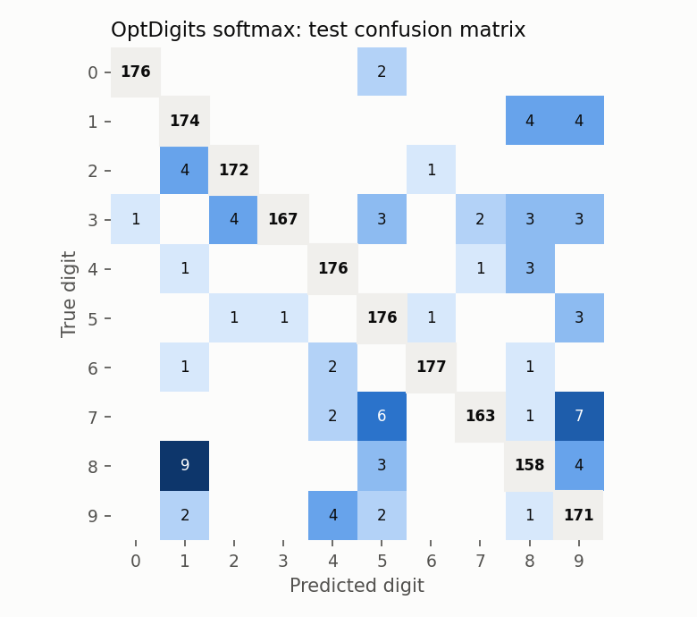
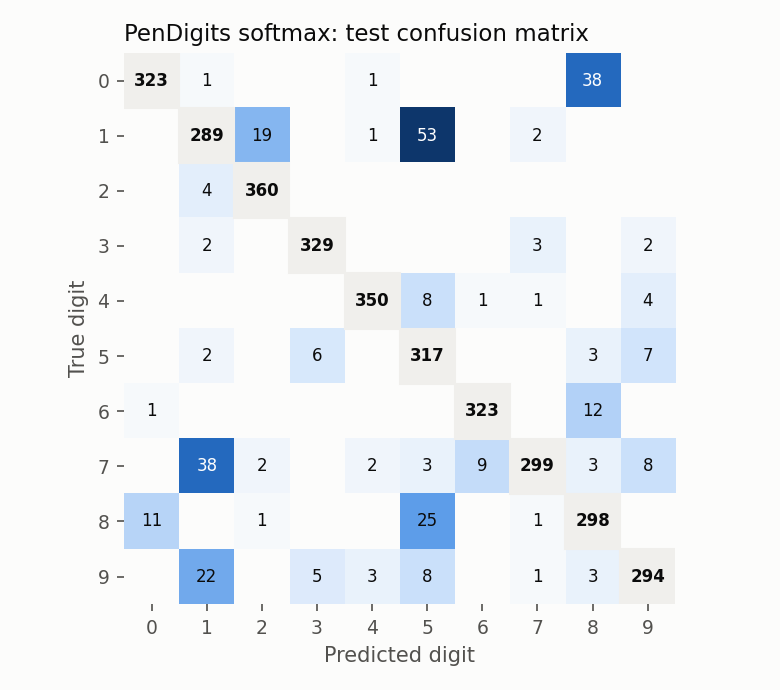
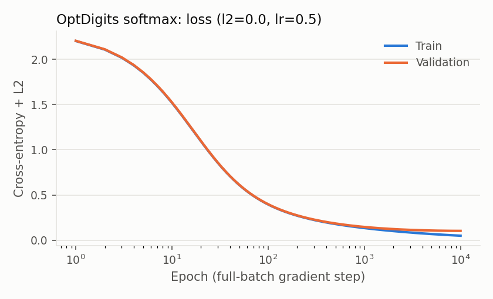
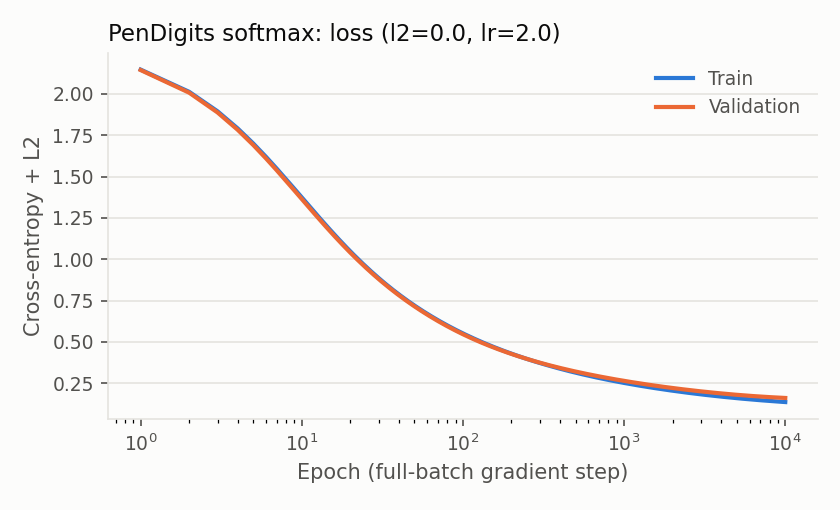

# CSCI 467 Project: Handwritten Digit Recognition (Optical vs. Pen-Based)

Chloe Chang, Raksheta Kulkarni, Jasmine Liu

We compare classifiers on two representations of the same task, predicting a digit 0–9:

- an **optical** representation: the finished image of the digit
- a **pen-based** representation: the trajectory of the stylus while the digit was written

This README covers:

- the datasets and how we split them
- the evaluation metrics
- the softmax-regression baseline and its results

## 1. Datasets

We did **not** collect or scrape these datasets ourselves. Both come from the UCI Machine Learning Repository and were created by Alpaydin et al. at Boğaziçi University. The raw files are in `dataset_467/`. Both are 10-class classification problems with no missing values.

### 1.1 OptDigits: Optical Recognition of Handwritten Digits

- **How it was made:** writers filled in preprinted forms. NIST preprocessing software extracted each digit, then centered and size-normalized it into a 32×32 binary bitmap. The bitmap is divided into non-overlapping 4×4 blocks, and the "on" pixels in each block are counted.
- **Input:** 64 integer features, an 8×8 grid of ink counts from 0 to 16, read row by row.
- **Output:** the digit class, 0–9 (last column).
- **Writers:** 43 in total. 30 wrote the training file and 13 *different* writers wrote the test file.

### 1.2 PenDigits: Pen-Based Recognition of Handwritten Digits

- **How it was made:** 44 writers each wrote about 250 digits in random order into 500×500 boxes on a WACOM pressure-sensitive tablet. The tablet recorded the pen's (x, y) position every 100 ms (pressure was ignored). Each trajectory was then preprocessed in two steps:
  - Normalized so that its larger dimension spans 0–100 while keeping the aspect ratio.
  - Resampled to T = 8 points, evenly spaced along the arc length. The authors chose T = 8 over 12 or 16 as the best accuracy/complexity trade-off.
- **Input:** 16 integer features (x₁, y₁, …, x₈, y₈), each from 0 to 100, in the order the points were written.
- **Output:** the digit class, 0–9.
- **Writers:** 30 wrote the training file and 14 *different* writers wrote the test file.

### 1.3 Splits

Our proposal calls for splitting **by writer**. A model that is tested on writers it has already seen can memorize their style, so it would look better than it really is on new handwriting.

| | OptDigits | PenDigits |
|---|---|---|
| Training file (`.tra`) | 3,823 digits, 30 writers | 7,494 digits, 30 writers |
| Test file (`.tes`) | 1,797 digits, 13 new writers | 3,498 digits, 14 new writers |
| **Our train split** | 1,934 | 5,997 (24 writers) |
| **Our validation split** | 946 (same writers as train) | 1,497 (6 held-out writers) |
| **Final train (train + all of `.tra`)** | 3,823 | 7,494 |
| **Test** | 1,797 | 3,498 |

How each split was made:

- **Test sets.** We use the official `.tes` files for both datasets. Their writers never appear in any training data, so the test sets are writer-independent.
- **PenDigits validation (writer-independent).** The processed `pendigits.tra` file has no writer column. However, the original UNIPEN files (`pendigits-orig.{tra,tes}.Z`) tag each sample with `.COMMENT <digit> <writer> <index>`, in the same order as the processed rows. We parse these tags to get a writer ID for every row: 1–30 in training (247–250 digits each) and 1–14 in test.
  - We hold out 6 of the 30 training writers as the validation set (about 20%), chosen with a fixed random seed (`seed=0`). The held-out writers are 2, 8, 9, 14, 17 and 22.
  - The code is in `load_pen_writers` and `train_val_split` in `src/data.py`.
- **OptDigits validation (writer-dependent: a known limitation).** OptDigits has no writer IDs anywhere. The authors built `optdigits.tra` by concatenating three files: their training set (rows 0–1933), validation set (rows 1934–2879) and writer-dependent test set (rows 2880–3822). We checked this by rebuilding the 8×8 features from the 32×32 bitmaps in `optdigits-orig.*.Z`; all 3,823 rows matched exactly.
  - We use the authors' training set as train and their validation set as validation. These two sets share writers, so OptDigits validation accuracy is optimistic about performance on new writers.
  - The test set is still writer-independent.
- After hyperparameter selection, each model is **retrained on the whole `.tra` file** and evaluated **once** on the test set.

### 1.4 Class distribution

Both datasets are close to balanced. In the official training and test files, the smallest class has at least 92% as many examples as the largest. The OptDigits validation split is less even (85 to 114 examples per class) because it is the authors' fixed split rather than a stratified one. You can regenerate these counts with `python3 -m src.data`.

**OptDigits**

| Split | 0 | 1 | 2 | 3 | 4 | 5 | 6 | 7 | 8 | 9 | Total |
|---|---|---|---|---|---|---|---|---|---|---|---|
| Train | 189 | 198 | 195 | 199 | 186 | 187 | 195 | 201 | 180 | 204 | 1,934 |
| Validation | 87 | 97 | 92 | 85 | 114 | 108 | 87 | 96 | 91 | 89 | 946 |
| Full `.tra` | 376 | 389 | 380 | 389 | 387 | 376 | 377 | 387 | 380 | 382 | 3,823 |
| Test | 178 | 182 | 177 | 183 | 181 | 182 | 181 | 179 | 174 | 180 | 1,797 |

The 943 writer-dependent-test rows of the `.tra` file are left out of the train/validation split but are included in the final retraining.

**PenDigits**

| Split | 0 | 1 | 2 | 3 | 4 | 5 | 6 | 7 | 8 | 9 | Total |
|---|---|---|---|---|---|---|---|---|---|---|---|
| Train (24 writers) | 624 | 623 | 624 | 575 | 624 | 576 | 576 | 624 | 576 | 575 | 5,997 |
| Validation (6 writers) | 156 | 156 | 156 | 144 | 156 | 144 | 144 | 154 | 143 | 144 | 1,497 |
| Full `.tra` | 780 | 779 | 780 | 719 | 780 | 720 | 720 | 778 | 719 | 719 | 7,494 |
| Test (14 writers) | 363 | 364 | 364 | 336 | 364 | 335 | 336 | 364 | 336 | 336 | 3,498 |

## 2. Evaluation metrics

All metrics are computed on the writer-independent test set (`src/metrics.py`).

| Metric | What it is | Why it fits this project |
|---|---|---|
| **Overall accuracy** | Fraction of test digits classified correctly. | The classes are nearly balanced (§1.4), so accuracy is not inflated by a majority class and works as the headline number. Prior work on these datasets reports it too, so we can compare against them. |
| **Per-class accuracy** | Recall for each digit, cm[k,k] / Σⱼ cm[k,j]. | Overall accuracy can hide one digit failing badly. This shows *which* digits each representation finds hard. |
| **Confusion matrix** | 10×10 counts of (true, predicted). | Our main research question is whether the two representations make *different kinds* of errors. Comparing which digit pairs get confused answers this directly, and later models can be judged on whether they fix those specific pairs. |
| **Per-writer accuracy** (PenDigits only) | Accuracy computed separately for each of the 14 test writers; we report the mean, standard deviation, min and max. | The goal is generalizing to *new handwriting*. The spread across writers shows whether a model works for everyone or fails on some writing styles. It is not possible for OptDigits, which has no writer IDs. |
| **Compute and memory** | Number of parameters, size in bytes, wall-clock training time and prediction time. | Digit recognizers run on tablets and form scanners. The proposal compares methods on cost as well as accuracy. |

## 3. Baseline: multiclass softmax regression

Code: `src/softmax.py` (model), `src/run_softmax.py` (experiment).

We chose softmax regression as the baseline because it is the simplest model that handles all 10 classes directly. Its decision boundaries are linear, so its confusion matrix shows which digit pairs are not linearly separable in each representation.

### 3.1 From input to output, step by step

1. **Read the raw row.** OptDigits gives 64 integers in [0, 16]; PenDigits gives 16 integers in [0, 100]. The last column is the label y.
2. **Rescale (no feature engineering).** Divide by the known maximum: x = raw / 16 for OptDigits and x = raw / 100 for PenDigits, so every feature lies in [0, 1].
   - This is a fixed linear rescaling, not learned and not data-dependent. It does not add features.
   - Its purpose is to keep gradient descent well-conditioned. The largest stable step size scales with 1/(feature scale)², so raw inputs would need learning rates about 256× smaller for OptDigits and about 10⁴× smaller for PenDigits.
3. **Compute class scores (logits).** z = Wᵀx + b, with W ∈ ℝ^{d×10} and b ∈ ℝ^{10}, where d = 64 for OptDigits and d = 16 for PenDigits. Each class k has its own weight vector w_k: a linear template over pixel blocks (OptDigits) or over pen coordinates (PenDigits).
4. **Convert scores to probabilities with softmax.**
   P(y = k | x) = exp(z_k) / Σ_j exp(z_j).
   For numerical stability we subtract max_j z_j from every logit before exponentiating; this does not change the result.
5. **Predict.** ŷ = argmax_k P(y = k | x).

### 3.2 Training

- **Loss:** mean cross-entropy plus L2 regularization on the weights (the bias is not regularized):
  L(W, b) = −(1/n) Σᵢ log P(yᵢ | xᵢ) + (λ/2)‖W‖²_F
- **Gradients:** with P the n×10 matrix of predicted probabilities and Y the one-hot labels,
  ∇_W L = Xᵀ(P − Y)/n + λW and ∇_b L = mean over rows of (P − Y).
  We checked these against a finite-difference gradient; the largest difference was below 1e-9.
- **Optimizer:** full-batch gradient descent, as in the proposal. W and b start at zero, so the whole procedure is deterministic.
- **Stopping:** stop when the training loss changes by less than 1e-7 between steps, or after 10,000 steps.

### 3.3 Hyperparameters

We grid-searched λ ∈ {0, 1e-5, 1e-4, 1e-3, 1e-2, 1e-1} × η ∈ {0.5, 1, 2}. Each model was trained on the train split, and we kept the pair with the best validation accuracy, breaking ties by validation loss. The max epochs (10,000) and tolerance (1e-7) were fixed. The chosen pair was then retrained on the full `.tra` file and tested once.

| | OptDigits | PenDigits |
|---|---|---|
| Chosen λ / η | 0 / 0.5 | 0 / 2.0 |
| Validation accuracy | 97.0% | 95.3% |

- **λ = 0 won.** Accuracy was flat for λ ≤ 1e-4 and fell for larger λ (down to 91.3% and 78.0% at λ = 0.1). With so few parameters, the model underfits rather than overfits, so regularization only hurts.
- **PenDigits is slightly undertrained.** Its best run hit the 10,000-step cap at the largest η. Our first search (3,000 steps, η ≤ 1) had the same problem, so we raised both.

The full grid is in `results/softmax/*.json`.

### 3.4 Results (test set, unseen writers)

| | OptDigits | PenDigits |
|---|---|---|
| **Test accuracy** | **95.2%** | **91.0%** |
| Train accuracy | 98.6% | 96.3% |
| Parameters / size | 650 / 5.2 KB | 170 / 1.4 KB |
| Train time / predict time | 7.6 s / 0.2 ms | 13.0 s / 0.3 ms |

For comparison, the dataset authors report 98.0% and 97.7% with 1-nearest-neighbour.

**Per-class test accuracy (%)**

| Digit | 0 | 1 | 2 | 3 | 4 | 5 | 6 | 7 | 8 | 9 |
|---|---|---|---|---|---|---|---|---|---|---|
| OptDigits | 98.9 | 95.6 | 97.2 | 91.3 | 97.2 | 96.7 | 97.8 | 91.1 | 90.8 | 95.0 |
| PenDigits | 89.0 | 79.4 | 98.9 | 97.9 | 96.2 | 94.6 | 96.1 | 82.1 | 88.7 | 87.5 |

**Top confusions (true → predicted, count)**

- OptDigits: 8→1 (9), 7→9 (7), 7→5 (6)
- PenDigits: 1→5 (53), 0→8 (38), 7→1 (38), 8→5 (25), 9→1 (22)

**Per-writer accuracy (PenDigits):** the mean is 91.0%, ranging from 80.3% to 97.6% across the 14 test writers.






### 3.5 Takeaways

- **The two representations fail differently.** OptDigits errors are small and spread out. PenDigits errors cluster in a few pairs, such as 1→5 and 0→8. A linear model on raw pen coordinates is sensitive to where a stroke starts and to stroke order. Later models should target these pairs.
- **New writers are harder.** PenDigits drops from 95.3% on validation writers to 91.0% on test writers. OptDigits' validation number is optimistic because its validation set shares writers with training.
- **The baseline is cheap.** Any heavier model must justify its cost against these numbers.

## 4. How to run

```bash
pip install -r requirements.txt   # numpy, matplotlib
python3 -m src.data               # dataset statistics
python3 -m src.run_softmax        # search + final fit + test (~3.5 min); outputs to results/softmax/
```

This requires `zcat`, which ships with macOS and Linux.

| Path | Contents |
|---|---|
| `src/data.py` | Loading, writer IDs, splits |
| `src/softmax.py` | Softmax model |
| `src/metrics.py` | Metrics |
| `src/run_softmax.py` | Experiment |
| `results/softmax/` | JSON + figures |
